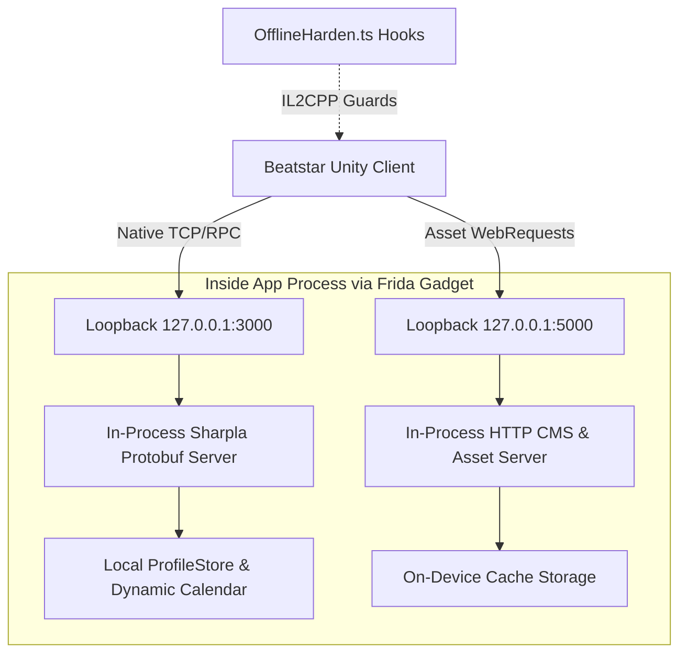

<div align="center">

# 🎵 Beatstar-Zero-Server

**The In-Process, Zero-Server Offline Preservation Engine for Beatstar (Android / ARM64)**

[](https://www.typescriptlang.org/)
[](https://www.python.org/)
[](https://frida.re/)
[](https://developer.android.com/)
[](https://developer.android.com/ndk/guides/abis)
[](LICENSE)

<p align="center">
  <i>Turn your mobile rhythm game into a permanent, self-contained handheld console experience.</i><br>
  <b>Zero external servers • Zero PC dependencies • 100% Offline anywhere</b>
</p>

---

</div>

> [!IMPORTANT]
> **Game Preservation & Educational Notice**  
> This repository contains **NO copyrighted game assets, audio banks (.wem/.bnk), or APK binaries**.  
> This project is designed strictly to study network protocols, binary instrumentation, and ensure game preservation. Users must provide their own legally obtained base game APK and audio cache.

---

## 🌟 What is Beatstar-Zero-Server?

Normally, mobile games rely on remote game servers for everything: logging in, fetching song lists, downloading track charts, and tracking progress. When servers go down or you're offline (in an airplane, subway, or traveling), the game becomes completely unplayable.

**Beatstar-Zero-Server solves this by moving the entire server inside the game client itself.**

Through Frida dynamic binary instrumentation and native ELF patching, the game's network requests never leave your device. An embedded QuickJS engine emulates the entire backend directly in local memory.

### 📊 How Does It Compare?

| Feature | 🌐 Traditional Private Servers | ⚡ Beatstar-Zero-Server |
| :--- | :---: | :---: |
| **Hosting Requirement** | External PC / Cloud VPS | **None** (Runs inside the phone's process) |
| **Internet Connection** | Required (Wi-Fi or Mobile Data) | **100% Offline** (Airplane Mode compatible) |
| **Network Configuration** | Complex (Wi-Fi Proxies, DNS, VPNs) | **Zero Setup** (Regular standalone APK) |
| **UI Freezes & Soft-Locks** | Common due to clock mismatches | **Hardened** with native IL2CPP watchdogs |
| **Event Calendar** | Static / Broken when dates pass | **Infinite Dynamic Loop** (Safe modular cycling) |

---

## ⚙️ How It Works (Under the Hood)



1. **Native Injection**: During the build pipeline, the game's `libmain.so` is patched with `DT_NEEDED` to automatically load `libfrida-gadget.so` upon startup.
2. **Embedded Runtime**: Frida loads our compiled TypeScript engine into a local QuickJS sandbox.
3. **Loopback Redirection**: All outgoing SpaceApe Sharpla TCP RPCs and CMS HTTP queries are routed internally to local ports (`127.0.0.1:3000` & `5000`).
4. **Resilient Hardening**: Unity IL2CPP hooks intercept `InteractionLocker`, preventing touch soft-locks, and dynamically loop seasons and Daily Shuffles without clock desyncs.

---

## 🚀 Quick Start (Building Your Offline Game)

We've designed the build system to be completely automated. Follow these 4 simple steps:

### 📋 Prerequisites

Before starting, ensure you have the following installed on your PC:
- **[Python 3.9+](https://www.python.org/)** with `lief`:
  ```bash
  pip install lief
  ```
- **[Node.js 18+](https://nodejs.org/)**
- **Android SDK Build-Tools** (`zipalign` and `apksigner` installed or in PATH)

---

### 📦 Step 1: Clone and Install Dependencies

```bash
git clone https://github.com/RandoTeam/Beatstar-Zero-Server.git
cd Beatstar-Zero-Server/tools/Beatstar-Script-Android
npm install
cd ../..
```

---

### 📂 Step 2: Add Your Game Files

1. **Base Game APK**:  
   Obtain an untouched ARM64 `Beatstar.apk` (e.g., from your own device backup or archive mirrors) and place it inside:
   ```
   input/Beatstar.apk
   ```

2. **Song Audio Cache**:  
   Copy your cached track assets from your Android device (`/Android/data/com.spaceapegames.beatstar/files/UnityCache`) into:
   ```
   assets_cache/UnityCache
   ```

---

### 🔨 Step 3: Run the 1-Click Build Pipeline

Run the automated Python builder:
```bash
python build_offline.py
```

**The script will automatically:**
- 🔹 Compile the TypeScript server into `file.js`.
- 🔹 Extract and prepare the native Frida gadget payload.
- 🔹 Patch `libmain.so` ELF headers to inject the gadget loader.
- 🔹 Bundle the offline CMS and asset configs into the APK package.
- 🔹 Align and sign the package with a debug keystore.

Your ready-to-install package will appear at:
```
dist/Beatstar-Offline-arm64.apk
```

---

### 📱 Step 4: Install & Enjoy

Install the APK to your Android device via ADB:
```bash
adb install dist/Beatstar-Offline-arm64.apk
```
*Launch the game, wait 5 seconds for the initial local bootstrap, and play anywhere without an internet connection!*

---

## 🛡️ Legal & Fair Use Disclaimer

- **Preservation & Research**: This project was developed as a software engineering case study in game preservation, binary instrumentation, and reverse engineering.
- **No Trademark Infringement**: Beatstar and SpaceApe Games are trademarks of Space Ape Ltd. This project is unaffiliated with, unauthorized by, and not endorsed by Space Ape Ltd or Supercell.
- **Zero Assets Distributed**: No game art, copyrighted music recordings, or proprietary game binaries are hosted in this repository.

---

## 🤝 Credits & Acknowledgments

This project stands on the shoulders of the community:
- **[ExternalAddress4401](https://github.com/ExternalAddress4401)** & the Beatstar Modding Community for early Frida scripts and protocol analysis.
- **[Frida](https://frida.re/)** by Ole André Vadstøld Ravnås & NowSecure for the dynamic binary instrumentation toolkit.
- **[LIEF Project](https://lief-project.github.io/)** for ELF binary manipulation.

*Full details can be found in [CREDITS.md](CREDITS.md).*

---

<div align="center">
  <b>Released under the <a href="LICENSE">MIT License</a>.</b>
</div>
